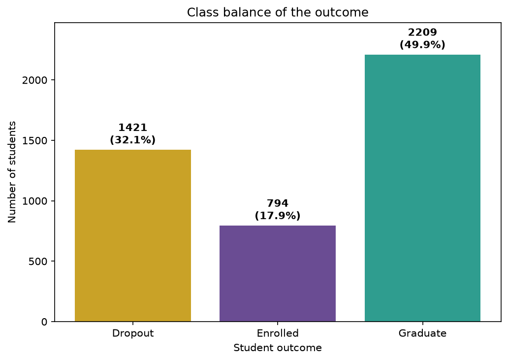
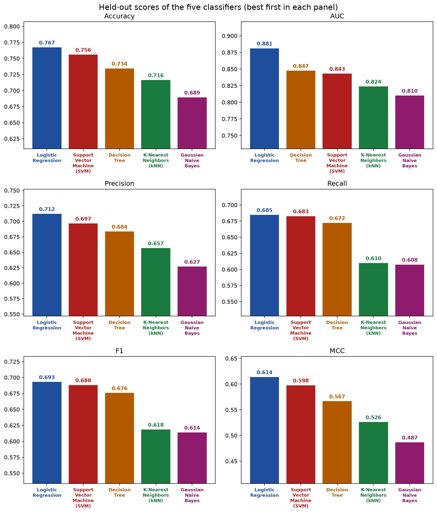
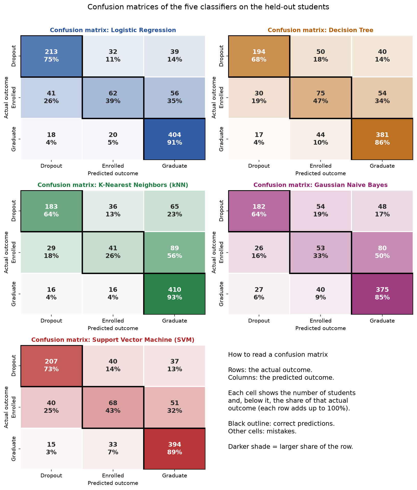
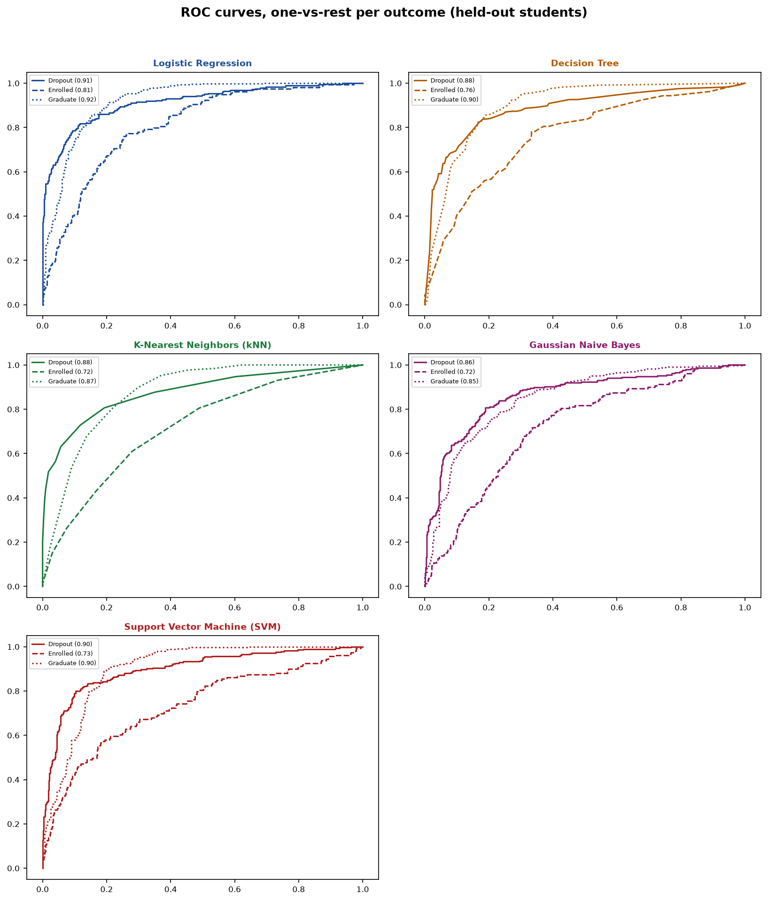
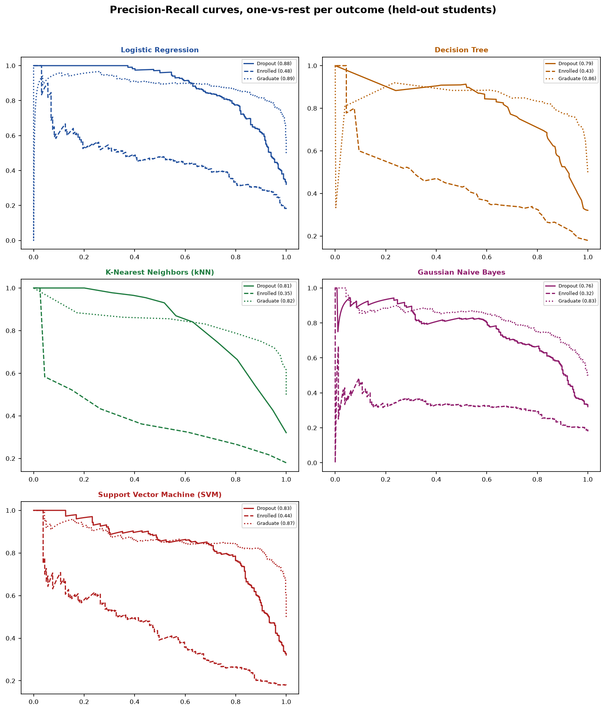
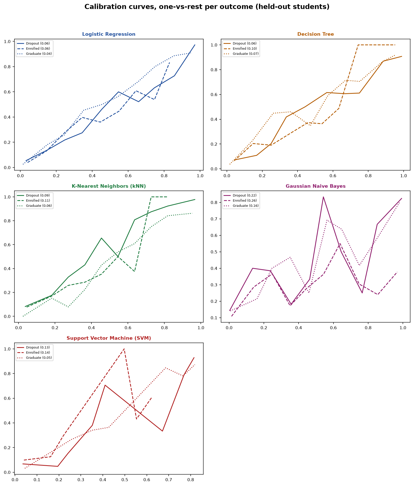
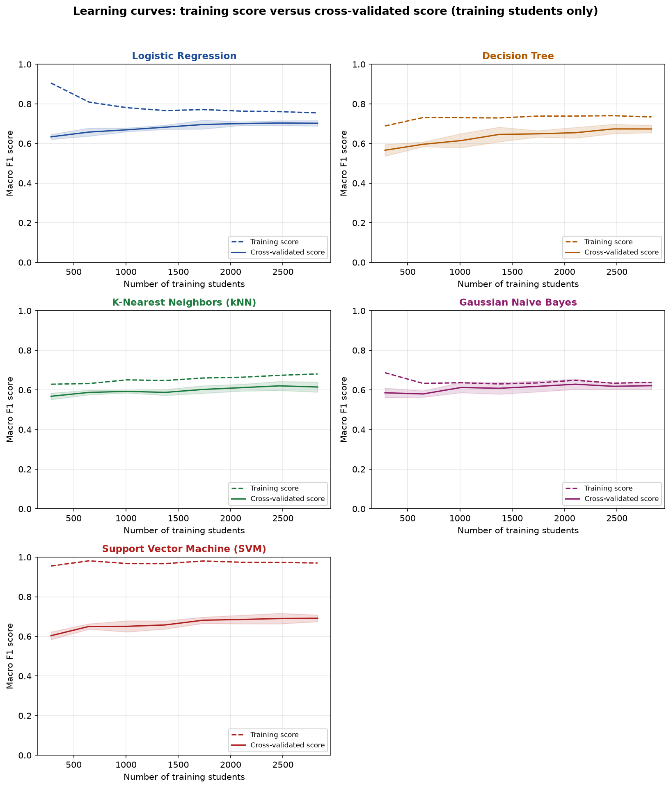
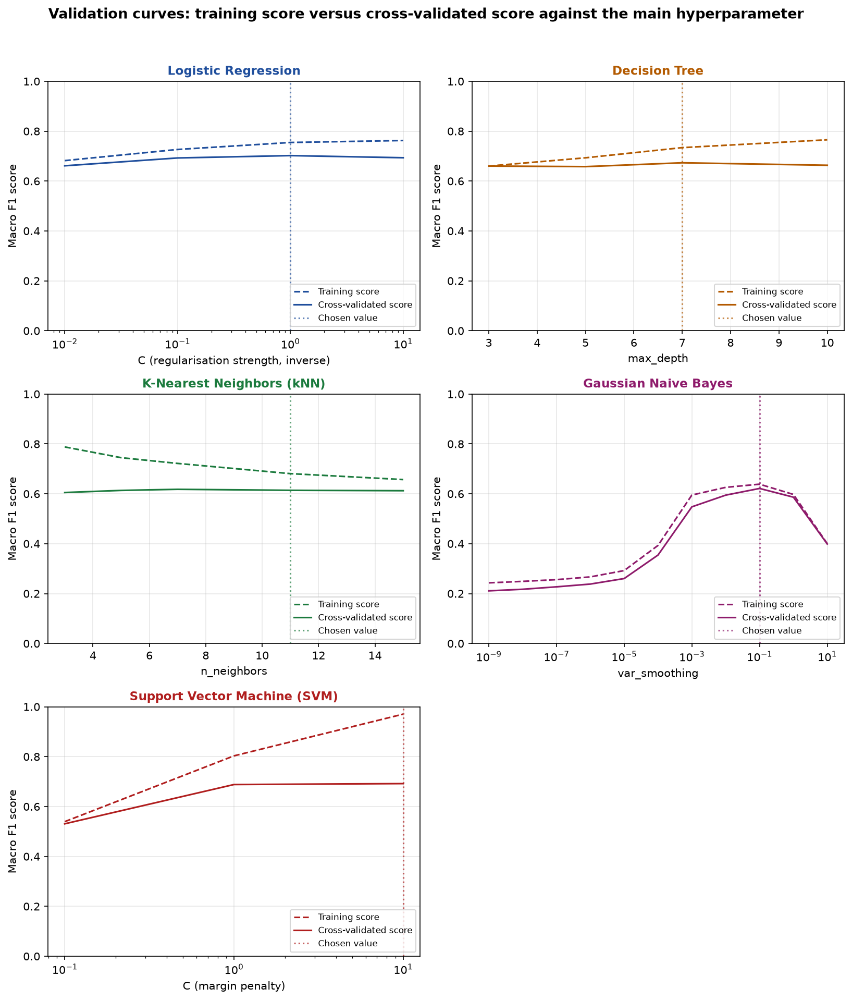

# GradPath AI

Predicting whether a student will drop out, stay enrolled, or graduate, from
academic and demographic records.

- **Repository:** https://github.com/ShivkumarSSoni/gradpath-ai

- **Live app:** https://gradpath-ai.streamlit.app/


## 1. Problem statement

Student attrition is a real, costly problem for any academic institution: a
dropout wastes the time the student already invested and the resources the
institution already spent, and an early warning gives both sides a chance to
act. This project trains and compares five classifiers that take a student's
enrolment details, demographic information and first-year academic record,
and predict one of three outcomes: **Dropout**, **Enrolled**, or
**Graduate**. The same five trained models are served through a Streamlit
app, where any test file in the same format can be uploaded and scored
against a chosen model, without retraining anything.

## 2. Dataset description

The dataset is the UCI *Predict Students' Dropout and Academic Success*
dataset (identifier 697): 4,424 students, 36 input columns and one three-way
outcome column, well above the minimum size generally expected for a
reliable multi-class classification study (500 rows, 12 features). The
columns describe the mode and course of enrolment, demographic
and socio-economic background, and first and second semester academic
results.

The 4,424 students break down as **Graduate 49.9%, Dropout 32.1%, Enrolled
17.9%**. The classes are imbalanced, with Enrolled the smallest and hardest
group, which is why this project reports macro-averaged Precision, Recall
and F1 together with the Matthews Correlation Coefficient (MCC), instead of
relying on plain accuracy alone. There are no missing cells and no duplicate
rows, so no imputation or row removal was needed.



Of the 36 input columns, 29 are integers and 7 are decimals. Nine integer
columns are really category codes rather than genuine measurements (for
example *Course* and *Marital Status*), so they are one-hot encoded; the
remaining numeric columns are scaled. Early academic performance separates
the outcomes clearly: the median second-semester grade is 0.0 for Dropout
students against 12.0 for Enrolled and 13.0 for Graduate students.

A stratified 80/20 split (fixed random seed 42) sets aside 3,539 students for
training and 885 for the held-out test set, with almost identical outcome
shares in both groups. The held-out 885 students are saved as `test_data.csv`
in this repository and are never used for training; they are what the
Streamlit app scores by default and what every metric below is measured on.

## 3. Models used

This project fixes all five classifiers below as the basis for
comparison; the choices made here are
how each one is set up and tuned for this dataset. They are trained on the
same 3,539 training students and measured on the same 885 held-out students,
so the comparison is fair.

| Classifier | Basic idea | Key characteristic |
|---|---|---|
| Logistic Regression | Weighs every column and turns the weighted sum into a probability for each outcome | Simple, fast, and a strong baseline once the columns are scaled |
| Decision Tree | Asks a chain of yes/no questions about the columns | Easy to follow and able to capture rules that are not straight lines |
| K-Nearest Neighbors (kNN) | Finds the most similar training students and lets them vote | Makes no assumption about the shape of the data |
| Gaussian Naive Bayes | Assumes the columns are independent within each outcome and multiplies their likelihoods | Very fast, and shows how far a strong simplifying assumption can go |
| Support Vector Machine (SVM) | Finds the boundary that separates the outcomes with the widest margin | Often strong on medium-sized tables of numbers |

Each saved model is a single scikit-learn pipeline: one-hot encoding and
scaling, followed by the classifier, fitted on the training students only.
The same preprocessing is therefore always applied automatically, whether
the data is the held-out set, a notebook check, or a file uploaded to the
app.

### 3.1 Comparison table

Read directly from `results/evaluation_results.csv`, the single source of
truth also used by the notebook and the Streamlit app.

| Model | Accuracy | AUC | Precision | Recall | F1 | MCC |
|---|---|---|---|---|---|---|
| Logistic Regression | 0.767 | 0.881 | 0.712 | 0.685 | 0.693 | 0.614 |
| Decision Tree | 0.734 | 0.847 | 0.684 | 0.672 | 0.676 | 0.567 |
| K-Nearest Neighbors (kNN) | 0.716 | 0.824 | 0.657 | 0.610 | 0.618 | 0.526 |
| Gaussian Naive Bayes | 0.689 | 0.810 | 0.627 | 0.608 | 0.614 | 0.487 |
| Support Vector Machine (SVM) | 0.756 | 0.843 | 0.697 | 0.683 | 0.688 | 0.598 |

Precision, Recall and F1 are macro averages; AUC is one-vs-rest, averaged
over the three outcomes; MCC is the multi-class Matthews Correlation
Coefficient, which needs no averaging choice.

**Why macro averages?** Precision, Recall and F1 have no single standard
averaging method for multi-class problems, so this was a deliberate choice. Macro
gives each of the three outcomes equal weight, however many students it has.
Enrolled is the smallest group (about 18%) and the hardest to find, and it is
also the group that most needs attention from the institution. A weighted
average would let the larger Graduate group dominate and hide a weak
Enrolled result. Macro also matches how the AUC above is averaged, so the
table uses one consistent view. No class weighting or resampling is used
anywhere; only stratified splits and stratified cross-validation folds keep
the outcome shares equal, without changing how the models themselves learn.
The Support Vector Machine's probabilities, needed for its AUC, come from a
sigmoid calibration step wrapped around it, since an SVM does not produce
probabilities on its own.

### 3.2 Observations table

| Model | Observation |
|---|---|
| Logistic Regression | A simple linear boundary already separates the three outcomes well; it is consistently among the strongest models on every metric above. Accuracy 0.767, AUC 0.881, Precision 0.712, Recall 0.685, F1 0.693, MCC 0.614. |
| Decision Tree | Splits on a few curricular-unit columns capture most of the signal, but it overfits more than the other models and trails on most metrics. Accuracy 0.734, AUC 0.847, Precision 0.684, Recall 0.672, F1 0.676, MCC 0.567. |
| K-Nearest Neighbors (kNN) | Performance depends heavily on the scaled distance between students; competitive overall, weaker on the rare Enrolled outcome. Accuracy 0.716, AUC 0.824, Precision 0.657, Recall 0.610, F1 0.618, MCC 0.526. |
| Gaussian Naive Bayes | Assumes the features are independent given the outcome, which does not hold well here, so it scores clearly lower than the other four. Accuracy 0.689, AUC 0.810, Precision 0.627, Recall 0.608, F1 0.614, MCC 0.487. |
| Support Vector Machine (SVM) | A wide-margin boundary with calibrated probabilities; close to the top overall and the strongest model specifically at recognising the Enrolled outcome. Accuracy 0.756, AUC 0.843, Precision 0.697, Recall 0.683, F1 0.688, MCC 0.598. |
| **Overall, Winner for selected dataset ?** | **Logistic Regression.** It has the best score on every one of the six metrics in Section 3.1. Its lead over the second-placed Support Vector Machine is about one percentage point of accuracy, close enough on 885 students that the two should be considered competitive, but Logistic Regression's ranking is consistent across all six metrics, which makes it the more defensible overall choice: 76.7% accuracy and an MCC of 0.614 on 885 students it never saw during training or tuning. |

Further patterns worth noting:

- **The Enrolled outcome is hard for every model.** Its recall ranges from
  26% to 47% across the five classifiers, against 64-75% for Dropout and
  85-93% for Graduate. Enrolled students sit between the other two outcomes
  (neither left nor finished yet), and the confusion matrices show most of
  them being predicted as Graduate or Dropout instead. This is exactly why
  macro-averaged scores and MCC, not plain accuracy, are reported here.
- **Tuning mattered most for Gaussian Naive Bayes.** Its cross-validated
  macro F1 on the training students rose from 0.211 at the default smoothing
  value to 0.621 at the chosen value (see Section 7.3).
- **Limits of this comparison:** the scores come from one 80/20 split, so
  differences of around one percentage point should not be over-read. The
  reasons given above are plausible explanations for each model's behaviour,
  not proven causes.

## 4. Repository contents

| Path | Contents |
|---|---|
| `app.py` | Streamlit entry point |
| `requirements.txt`, `requirements-dev.txt` | Runtime and development dependencies, exact versions pinned |
| `README.md` | Details about this project | 
| `test_data.csv` | The 885-student held-out test split used by the app and by Section 3 |
| `model/` | The five saved, trained classifiers (`.joblib`) |
| `notebooks/gradpath_end_to_end_analysis.ipynb` | The full, top-to-bottom analysis and training notebook |
| `results/evaluation_results.csv` | The single source of truth for every score in this README |
| `data/student_records.csv` | A committed local cache of the full UCI dataset |
| `docs/images/` | The dataset, score comparison, confusion matrix and curve images embedded above |
| `src/gradpath/` | The importable backend and frontend package described in Section 7.5 |
| `tests/` | Unit and integration tests |
| `tools/` | The scripts that generate the images in `docs/images/` |

## 5. Streamlit app

The live app at https://gradpath-ai.streamlit.app/ loads one of the five
already-trained, already-saved models and scores an uploaded CSV; it never
retrains anything. Features:

- Upload a test CSV (up to 5 MB, 10,000 rows) in the same column format as
  `test_data.csv`.
- Choose any one of the five trained models from a dropdown.
- View the Confusion matrix and the full Classification report for that
  run.
- View all six evaluation metrics as metric cards, colour-coded to the
  selected model.
- View the same ROC, Precision-Recall and calibration curves as Section 7.4,
  **live** for the uploaded file and the selected model.


## 6. How to run Streamlit app locally

```bash
git clone https://github.com/ShivkumarSSoni/gradpath-ai.git
cd gradpath-ai
python -m venv .venv
# Windows: .venv\Scripts\activate   |   Linux/macOS: source .venv/bin/activate
pip install -r requirements.txt
streamlit run app.py
```

The notebook can be run top to bottom the same way, after also installing
`requirements-dev.txt` for Jupyter support; it writes `model/`,
`results/evaluation_results.csv` and the images in `docs/images/` from
scratch and reads `data/student_records.csv` instead of downloading the
dataset again.

## 7. Appendix: Additional Analysis

The sections below go deeper than the core comparison above: the
score and confusion-matrix breakdowns, the hyperparameter search, and the
supporting curves that together justify the overall winner for this
dataset.

### 7.1 Score comparison, one panel per metric

Each panel ranks the five classifiers on one metric, best first, with the
exact score above every bar. Every classifier keeps the same colour in every
chart in this README, matching the Streamlit app.



### 7.2 Confusion matrices

A confusion matrix compares what each student actually did (rows) with what
the model predicted (columns). Each cell shows the count of students and,
below it, that count as a share of its own row, so every row adds up to
100%; shares, not raw counts, decide the shade, since Graduate has 442
held-out students and Enrolled only 159. The black outline marks correct
predictions.



All five models mix up Enrolled students with Dropout and Graduate far more
than they mix up Dropout and Graduate with each other, which is the same
Enrolled weakness already visible in the comparison table above.

### 7.3 Hyperparameters searched and chosen

Every classifier's hyperparameters were chosen by 5-fold stratified
cross-validation on the training students only, scored by macro F1; the
held-out students played no part in this choice.

| Model | Hyperparameter | Values searched | Chosen value | At the edge of the search range? |
|---|---|---|---|---|
| Logistic Regression | `C` (inverse regularisation strength) | 0.01, 0.1, 1.0, 10.0 | 1.0 | No |
| Decision Tree | `max_depth`, `min_samples_leaf` | depths 3, 5, 7, 10; leaves 5, 10, 20 | depth 7, leaves 10 | No |
| K-Nearest Neighbors (kNN) | `n_neighbors`, `weights` | 3, 5, 7, 11, 15; uniform, distance | 11, uniform | No |
| Gaussian Naive Bayes | `var_smoothing` | 1e-9 to 10.0 (11 values) | 0.1 | No |
| Support Vector Machine (SVM) | `C` (inverse regularisation strength) | 0.1, 1.0, 10.0 | 10.0 | **Yes** (largest candidate tried) |

A candidate is a complete setting, not one model: every combination in a
model's grid is scored once per cross-validation fold, so the search cost
also varies by model.

| Model | Combinations tried | Cross-validation fits (combinations x 5 folds) | Cross-validated macro F1 of the chosen combination |
|---|---|---|---|
| Logistic Regression | 4 | 20 | 0.702 |
| Decision Tree | 12 | 60 | 0.673 |
| K-Nearest Neighbors (kNN) | 10 | 50 | 0.619 |
| Gaussian Naive Bayes | 11 | 55 | 0.621 |
| Support Vector Machine (SVM) | 3 | 15 | 0.692 |

The Support Vector Machine's chosen `C = 10.0` sits at the top of its
searched range; its validation curve (Section 7.4.5) shows the
cross-validated score still rising at that point, so a wider grid might find
an even better value, a direction not pursued here given the time available.
Gaussian Naive Bayes needed the widest search: with the library's tiny
default smoothing of 1e-9, a rare one-hot column gets an almost-zero
variance, so a single matching student can swing the prediction to one
class; its cross-validated macro F1 rose from 0.211 at that default to 0.621
at the chosen 0.1.

One caveat applies to every model above: the preprocessing step (one-hot
encoding and scaling) is fitted once on all training students before
cross-validation begins, so each validation round is influenced, in a very
small way, by scaling values that include its own validation students. This
affects only the cross-validation scores used to choose hyperparameters; the
held-out test scores in Section 3.1, which is what this project reports as
the result, never see this effect, since the held-out students are
completely separate from the whole training and tuning process.

### 7.4 Curves

Computed once on the held-out students from each saved model's own
predicted probabilities, and shown here as images; the Streamlit app draws
the same three curve types live for whichever model and file a user selects.

#### 7.4.1 ROC curves
All five models separate Graduate students most easily and Enrolled students
least easily, matching the AUC column in Section 3.1.



#### 7.4.2 Precision-Recall curves
Precision-Recall matters most for the rare Enrolled outcome: a high ROC area
can still hide weak performance on a small class, since ROC's false positive
rate is diluted by the two larger classes. The Enrolled curve sits
noticeably below Dropout and Graduate for every model.



#### 7.4.3 Calibration curves
A calibration curve compares each model's predicted probability against how
often that outcome actually occurred among held-out students at that
predicted probability; a curve that tracks the diagonal is well calibrated.



#### 7.4.4 Learning curves

Each panel refits a model, with its already-chosen hyperparameters, on
growing subsets of the training students. The Support Vector Machine shows
the widest gap between its training score and its cross-validated score;
Gaussian Naive Bayes the narrowest. All five cross-validated lines are close
to flat by 2,500-2,800 training students, so collecting more students of the
same kind is unlikely to change the ranking above.



#### 7.4.5 Validation curves
Each panel sweeps one model's main hyperparameter while the others stay
fixed at their chosen value. Logistic Regression and the Decision Tree are
close to flat across most of their range, so their exact chosen value
matters little. Gaussian Naive Bayes peaks sharply at its chosen
`var_smoothing = 0.1`. The Support Vector Machine's cross-validated score is
still rising at `C = 10`, the edge case already flagged in Section 7.3.



#### 7.4.6 Training versus held-out score - quick overfitting check

A quick overfitting check that needs no new fitting: each already-fitted
pipeline's macro F1 on the training students it was fitted on, next to its
already-recorded macro F1 on the held-out students from Section 3.1.

| Model | Training F1 (macro) | Held-out F1 (macro) | Gap (training minus held-out) |
|---|---|---|---|
| Logistic Regression | 0.749 | 0.693 | 0.056 |
| Decision Tree | 0.748 | 0.676 | 0.072 |
| K-Nearest Neighbors (kNN) | 0.687 | 0.618 | 0.069 |
| Gaussian Naive Bayes | 0.635 | 0.614 | 0.022 |
| Support Vector Machine (SVM) | 0.965 | 0.688 | 0.277 |

Gaussian Naive Bayes has the smallest gap, since its simplifying assumption
keeps it from fitting the training students too closely in the first place.
The Support Vector Machine has by far the largest gap, consistent with the
widest gap already seen in its learning curve; it remains competitive on the
held-out students regardless (Section 3.1), so this is overfitting on the
training set rather than a sign that its held-out score is unreliable.
Logistic Regression, the Decision Tree and kNN sit in between.

### 7.5 Architecture

The backend and frontend are separated into layers with a strict one-way
call direction:

```
frontend pages -> components / view_models -> backend_gateway
  -> controllers -> services -> repositories / ml -> domain
```

A layer may only call the layer directly below it. The `domain` package
holds plain business concepts (classifier kinds, evaluation scores, the
feature catalog) and imports nothing from Streamlit, pandas I/O or
scikit-learn. Controllers stay thin: they validate input, delegate to a
service, and shape the response. All business logic lives in services, which
depend only on the abstract repository classes in
`repositories/interfaces/`; concrete repositories (joblib model files, the
CSV results file, the UCI download) are built and injected in exactly one
place, `backend/dependency_wiring.py`. Streamlit calls live only in
`frontend/` and `app.py`.

```
src/gradpath/
├── backend/
│   ├── domain/          business concepts, no framework imports
│   ├── schemas/         request and response objects between layers
│   ├── controllers/     thin entry points: evaluation, comparison, training
│   ├── services/        business logic (training, evaluation, comparison,
│   │                    upload validation, results recording)
│   ├── repositories/    data access, behind abstract interfaces
│   ├── ml/              classifier builders, metrics and curve calculators
│   └── config/          one settings module for every path and constant
├── charts/              matplotlib drawing shared by the notebook, the
│                        README image script and the Streamlit app
└── frontend/            Streamlit only: pages, components, view models,
                         state and styling, reached through backend_gateway
```

Adding a sixth classifier means one new builder file in
`ml/classifier_builders/` plus one registry line, with no changes to any
controller or service. Adding a seventh metric is the same: one new
calculator registered in its own registry.
